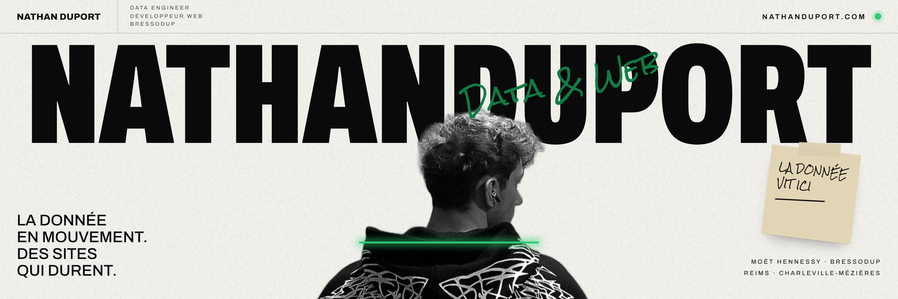

# Nathan Duport

**Data Engineer en alternance chez Moët Hennessy · développeur web chez [BressoDup](https://bressodup.fr)**  
Reims & Charleville-Mézières, Marne et Ardennes.

👉 **Portfolio : [nathanduport.com](https://nathanduport.com)**

---

Le jour, je construis des flux de données : pipelines Python & SQL, modèles BigQuery sur Google Cloud, et une documentation qui permet de reprendre ce que je livre.  
Le soir, je conçois et mets en ligne des sites rapides avec Arthur Bresson sous le nom **BressoDup**, avec un Lighthouse de 90 minimum inscrit au contrat.

Étudiant en BUT Informatique à l'IUT de Reims-Châlons-Charleville (URCA) et délégué de ma promo, après un bac mention Bien (maths & NSI, option cinéma-audiovisuel) au lycée Saint-Paul de Charleville-Mézières.

### Projets

| Projet | En bref | Stack |
|---|---|---|
| [Salle Tracker](https://salle-tracker.vercel.app) | Suivi de musculation pensé pour le téléphone : séries, charges et records entre potes | Next.js |
| [BressoDup](https://bressodup.fr) | Le site de notre micro-entreprise : offre lisible, estimateur, SEO local | React · Vite |
| [Dimensional Pulse](https://github.com/nathanduport/GameJam) | Jeu de game jam en duo : fusionner des gemmes, basculer entre deux dimensions | Python · Pygame |
| [CoLive](https://github.com/nathanduport/GestionLogementEtudiants) | Plateforme de logements étudiants, construite à cinq | Symfony · MySQL |
| [Labyrinthes](https://github.com/nathanduport/PythonLabyrinthesSAE) | Générer, résoudre et mesurer des labyrinthes (BFS, DFS, sidewinder) | Python · Jupyter |
| [Ludothèque](https://github.com/nathanduport/GestionBDDdeJeuxVideos) | Application PHP orientée objet sur PDO | PHP · MySQL |

### Boîte à outils

**Data** : Python, SQL, BigQuery, Google Cloud, Pandas, Jupyter  
**Web** : React, TypeScript, Astro, Next.js, Tailwind, Symfony, PHP  
**Ops & SEO** : Git, Docker, Vercel, Linux, Lighthouse, Search Console

### Savoir-être & langues

Leadership · Communication · Rigueur & autonomie  
Français (natif) · Anglais B2+ · Espagnol B1+

### Me contacter

[nathanduport.com](https://nathanduport.com) · [LinkedIn](https://www.linkedin.com/in/nathan-duport) · [contact.nduport@gmail.com](mailto:contact.nduport@gmail.com)
